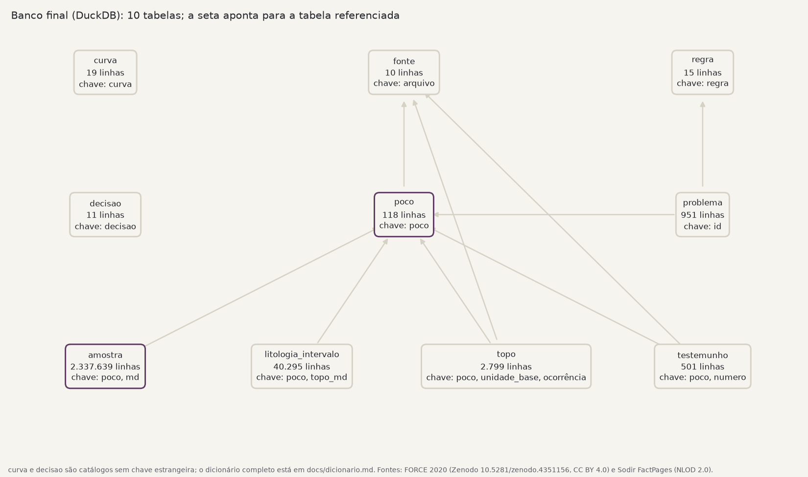

# Base de poços: consolidação e controle de qualidade

Uma base de 118 poços do Mar do Norte norueguês montada a partir de duas fontes públicas
que não concordam entre si: perfis, litologia, topos de formação, testemunhos e cadastro
oficial num banco só, com cada problema marcado, cada divergência explicada e cada linha
ligada ao arquivo de onde veio.

> **De onde vem o dado.** Perfis e litologia: **FORCE 2020** (Zenodo,
> [DOI 10.5281/zenodo.4351156](https://doi.org/10.5281/zenodo.4351156), CC BY 4.0; dado
> original do governo norueguês sob NLOD 2.0). Cadastro, topos e testemunhos oficiais:
> **Sodir FactPages** ([factpages.sodir.no](https://factpages.sodir.no), NLOD 2.0), snapshot
> de 2026-10-31. Tudo é dado público. Nada vem de projeto de trabalho, e nada é sintético.
> A coleta registra URL, data e hash de cada arquivo em `data/raw/manifesto.csv`.

## O problema

Quem interpreta poço raramente recebe um dado só. Recebe o perfil de um lugar, o cadastro de
outro e uma tabela de topos de uma terceira época, e as três discordam em nome de poço,
grafia de unidade, profundidade e código de ausência. Antes de qualquer interpretação, alguém
precisa decidir o que casa com o quê, o que está errado e o que só parece errado.

Este repositório faz esse trabalho de ponta a ponta e deixa as escolhas à vista: as regras de
qualidade estão em configuração, as decisões estão registradas com evidência, e o que precisa
de julgamento humano vira uma ficha por poço, não uma correção silenciosa.

## Antes e depois

<!-- numeros:inicio -->
| O quê | Antes | Depois | Como |
|---|---|---|---|
| Poços ligados ao cadastro oficial (Sodir) | 116 de 118 pelo nome | **118 de 118** | dois desvios técnicos mapeados por posição e mesa rotativa (D01, D02) |
| Topos de 2020 casados com os topos oficiais de hoje | 4 pelo nome exato | **2.768** | nome-base, grafia norueguesa, duas renomeações (D03) |
| Amostras com profundidade medida (MD) | 2.221.893 | **2.337.639** | índice do LAS no lugar da coluna de trajetória (D06) |
| Códigos de ausência de dado | 2 (−999,25 e −999) | **1 (NULL)** | 29.535 valores trocados em 34/11-2 S (D10) |
| Topos oficiais com profundidade vertical (TVDSS) | 0 (a Sodir publica só MD) | **2.668** | interpolação na trajetória do perfil |
| Problemas registrados com regra, poço e intervalo | 0 | **951** | 15 regras em config/regras.yaml; marcam, não corrigem |
<!-- numeros:fim -->

O dado medido não foi alterado. O que muda é o que fica ligado, comparável e marcado. A
completude das curvas é medida, não preenchida; o relatório mostra quanto falta de cada uma.

Alguns achados:

- dois poços do FORCE são desvios técnicos (`ST3`, `T4`) que a Sodir registra sob o ramal de
  origem; a ligação foi feita por posição e mesa rotativa (D01, D02);
- 26 topos foram reinterpretados pela Sodir depois de 2020, 13 deles no topo da Formação
  Utsira, com até 409 m de diferença; em um poço, 27 topos mudaram 3 m de uma vez, o que é
  mudança de referência, não de interpretação (D05);
- o PEF passa de 10 em 59 poços: é a baritina da lama, não a rocha; o valor fica e o trecho
  é marcado (D11);
- um poço usa −999 como nulo, diferente do −999,25 declarado no cabeçalho (D10);
- a lama (`MUDWEIGHT`) não declara unidade em nenhum poço e aparece em três escalas; ficou
  fora do banco (D09).

## Onde olhar

| Para | Abra |
|---|---|
| Visão geral, com números e figuras | [`docs/relatorio.html`](docs/relatorio.html) (baixar e abrir no navegador) |
| O que cada poço precisa de quem interpreta | [`docs/fichas/`](docs/fichas/README.md), uma ficha por poço, pior nota primeiro |
| Por que cada escolha foi feita | [`docs/decisoes.md`](docs/decisoes.md), D01 a D11 |
| Tabelas e colunas do banco | [`docs/dicionario.md`](docs/dicionario.md), gerado dos comentários do próprio banco |
| Perguntas respondidas em SQL | [`docs/consultas.md`](docs/consultas.md) |
| As regras de qualidade | [`config/regras.yaml`](config/regras.yaml) |

## Como funciona



O pipeline roda em etapas; cada uma lê o que a anterior gravou em disco.

| Etapa | Módulo | O que faz |
|---|---|---|
| Coleta | `pocos.collect` | baixa as fontes de `config/fontes.yaml`, confere o checksum publicado e grava o manifesto |
| Inventário | `pocos.inventory` | lê o cabeçalho de cada LAS e cruza os nomes com o cadastro |
| Padronização | `pocos.standardize` | mnemônicos e unidades pelo catálogo, nomes de poço, profundidade (MD e TVDSS) e coordenadas (ED50 → WGS84) |
| Qualidade | `pocos.quality` | 15 regras com gravidade; marcam o problema com poço, curva e intervalo, nunca corrigem |
| Conciliação | `pocos.reconcile` | topos de três versões, posição, mesa rotativa, profundidade final e testemunhos |
| Banco | `pocos.database` | DuckDB com chaves, restrições e comentários (`sql/esquema.sql`) |
| Exportação | `pocos.export` | um LAS 2.0 por poço, com as marcas de qualidade, e os topos oficiais em formato de importação |
| Entregas | `pocos.report` | o relatório, as fichas e o quadro de antes e depois deste README |

Os princípios que guiaram as escolhas:

- **Configuração fora do código.** Mudar uma faixa física, uma regra ou uma fonte é mudar um
  YAML.
- **Marcar, não corrigir.** Um valor estranho fica no banco com uma marca; quem interpreta
  decide se descarta.
- **Toda decisão com evidência.** Quando as fontes discordam, vale a mais oficial e mais
  recente, e a divergência fica registrada.
- **Linhagem.** Cada linha aponta para o arquivo de origem, e cada arquivo tem hash no
  manifesto.

## Como rodar

Precisa de [uv](https://docs.astral.sh/uv/). A coleta baixa cerca de 330 MB.

```bash
uv sync
uv run python -m pocos.pipeline   # coleta, padroniza, valida, concilia, monta o banco e gera as entregas
uv run pytest                     # testes das regras, da conciliação, do esquema e das entregas
```

Cada etapa também roda sozinha (`uv run python -m pocos.quality`, por exemplo). O banco
(`data/processed/base_pocos.duckdb`) e os LAS exportados ficam fora do Git e se recriam com o
pipeline.

## O que este case não cobre

Petrel, OpenWorks e Techlog são software pago; a exportação em LAS e em tabela de topos é o
ponto de entrega para eles. Também não há nuvem: o pipeline roda numa máquina comum.

## Licença

O dado segue a licença das fontes: CC BY 4.0 (FORCE 2020) e NLOD 2.0 (Sodir). Ao reusar,
cite as duas.
